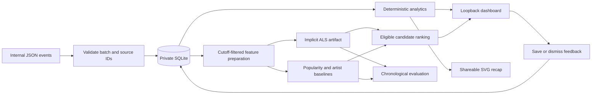

# Architecture and current boundaries

`store.py`: ingestion, atomic validation, source identity preservation.
`analytics.py`: exact event counts, reported-duration coverage, offset-aware ranges.
`model.py`: training-only feature preparation, reference ALS, persistence, ranking.
`evaluate.py`: full training-catalog metrics and eligibility rules.
`recap.py`: escaped, deterministic SVG rendering. `web.py`: presentation/feedback.

No source adapters, catalog ingestion, local-library matching, or audio access yet.
No model is loaded unless explicitly provided. Save/dismiss is stored separately
from implicit plays; it does not silently retrain the model. A dismissal filters
the dashboard's top candidates; backfilling beyond the initial top ten is pending.
There is no automatic model retraining or external network call in the app.

This server is a local development server with no account authentication. Bind is
loopback-only. Keep it local; authenticated self-hosted deployment is a later task.
Private artifact files may contain listener IDs and interaction matrices. Do not
publish them. An ignored path prevents accidental Git additions, not all exposure.

## Navidrome verification

Read primary sources on 2026-11-03:

- https://github.com/navidrome/navidrome/blob/master/README.md
- https://github.com/opensubsonic/open-subsonic-api/blob/main/content/en/docs/Endpoints/ping.md

OpenSubsonic `ping` is a connectivity/authentication request, and its response can
include protocol `version`, server `type`, `serverVersion`, and `openSubsonic`.
Protocol version is not the Navidrome application version. A concrete server has
not been contacted. Capabilities must be probed on that server; do not assume the
documentation's example version is installed. Before implementation, inspect the
authentication and library-browsing endpoint documentation and relevant extensions.
Use HTTPS and read-only requests; never update Navidrome's database directly.
The library catalog is not automatically an exact listening-event archive.
