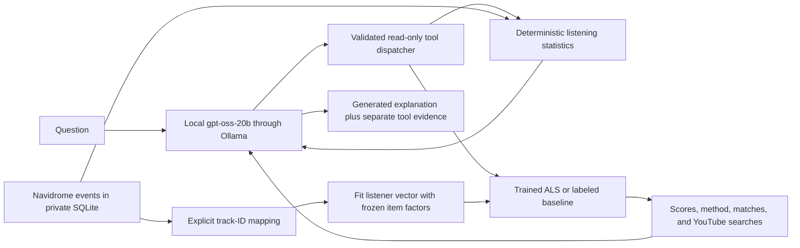

# Audino: trained recommendations with a local agent

The portfolio centerpiece is a trained and evaluated recommender. A local
**gpt-oss-20b through Ollama** controller chooses bounded tools and explains their
results. It does not calculate statistics, invent candidates, or replace ranking.
There is no GPT fine-tuning in this revision. Calling a pretrained model is
integration work; fitting/evaluating the recommender is the model-training work.

## What is implemented and what is verified

- Reference CPU implicit ALS training, persisted item/listener factors, validated
  artifact loading, explicit training parameters, and training-data fingerprint.
- Popularity and artist-affinity comparisons under the same full-catalog protocol.
- New-listener ALS vector fitting with frozen item factors and explicit ID matches.
- Bounded validation grids across random seeds, frozen chronological windows,
  per-run JSON metrics and a Markdown baseline comparison. Final test is unrun.
- Local Ollama tool-calling loop with two read-only tools: deterministic summary
  and recommendations. The configured listener, interval, artifact, and identity
  map come from the CLI, not model-supplied paths or SQL. No shell tool exists.
- Fictional artifacts are refused for personal recommendations unless explicitly
  using demo mode. Unmatched history produces a labeled popularity fallback.
- Tool results accompany generated text. Generated narration can still be wrong;
  it is not independently verified or a replacement for the evidence payload.

Tests use scripted Ollama responses, not a real model. Four fixture training runs
completed in the cloud instance. Desktop gpt-oss inference, GPU utilization,
real-data training quality, and personal recommendation relevance are **unverified**.
No benchmark improvement, internship outcome, or real-user satisfaction is claimed.

## Agent architecture



The model can request up to six tool calls across four rounds. Tools cannot
access other listeners, arbitrary files, shell commands, websites, Navidrome
credentials, or your Obsidian vault. Unknown tools/arguments are rejected.
Metadata is treated as untrusted data. The protocol is tested; prompt wording
alone is not a guarantee of faithful narration.

## Desktop Ollama check (Fish-compatible)

Run on Enrique's desktop, not the Debian Navidrome VM or cloud executor:

```sh
cd ~/Projects/Audino
git pull --ff-only origin main
ollama --version
ollama list
.venv/bin/python -m music_discovery ollama-check
```

The default name is `gpt-oss:20b`. Use the exact local tag with `--model` if needed.
The checker reads `/api/version`, `/api/tags`, and `/api/show` and requires tool
capability. It does not run inference. If Ollama is not listening, start it using
your existing Ollama service or `ollama serve` in another terminal. Do not expose
port 11434 publicly. Cloud tags and API-reported remote-backed models are refused.
All application requests go to loopback; separately verify your Ollama runtime
uses local weights and no external routing. No model is downloaded automatically.

Try actual inference against your personal database, without a fixture ranker:

```sh
.venv/bin/python -m music_discovery --db private/navidrome.sqlite agent --listener enrique --start 2026-01-01T00:00:00-05:00 --timezone America/New_York --question "Summarize my listening using the tools. Is there enough matched data to recommend tracks?"
```

This reads local history and returns JSON with the answer and tool evidence.
Authentication tokens are never part of the prompt. Output contains private
listening metadata; keep it out of public screenshots. No transcripts are saved
automatically. Run `ollama ps` while a request is active to observe processor/GPU
use. Record Ollama version, model tag/quantization, context size, actual hardware,
latency, and memory before reporting performance. The RX 9070 XT, its driver,
Ollama backend, and usable memory have not been inspected from the cloud.

## Train and compare the recommender

Run the existing fixture generation/import commands first, into the separate demo
database. Then execute the bounded validation-only pipeline:

```sh
.venv/bin/python -m music_discovery --db private/demo.sqlite validate-experiment --config examples/fixture-experiment.json --output-directory artifacts/fixture-validation-v2
```

The output directory must be new; existing results are never overwritten. Inspect
`comparison.md`, `validation-summary.json`, `frozen-config.json`, and model/report
pairs. Four fits compare 8/16 factors across seeds 42/43. Every report contains
popularity, artist affinity, and ALS for both discovery and repeat ranking.
**All fixture results are pipeline checks, not recommendation-quality evidence.**

For real training, acquire a licensed timestamped multi-listener subset using the
source-review steps in `experiment.md`, document provenance and subset checksum,
and create a private config with fixed train/validation/test dates. A `data_kind`
label is a declaration, not automatic license verification. Tune only validation.
The runner records but never scores its final test interval; the standalone
evaluation CLI still exists, so discipline is required to keep that set untouched.
Do not call fixture data public listening history or claim one listener is a
collaborative population. The only personal history verified in the walkthrough
so far is one scrobble; we have not inspected later desktop data.

## Personalization into an external trained catalog

Navidrome IDs do not automatically equal public dataset IDs. Unknown artist names
and a title containing an artist string do not establish a match. Keep a private,
reviewed mapping array with entries shaped like this schema (not a real match):

```json
[
  {
    "source": "navidrome:home",
    "track_id": "YOUR_NAVIDROME_TRACK_ID",
    "model_source": "VERIFIED_DATASET_SOURCE",
    "model_track_id": "VERIFIED_CATALOG_TRACK_ID"
  }
]
```

Supply `--artifact artifacts/YOUR_REAL_MODEL.npz --mapping private/track-map.json`
to the `agent` command after real training and identity review. Matching events
fit a listener vector using the same confidence-weighted ALS objective while
item factors remain frozen. This is personalization, not GPT training or a
population-model retrain. The result reports matched/unmatched event counts;
zero matches means popularity fallback. Discovery excludes matched heard items;
repeat recommendations include only those heard items. Unmapped heard tracks
cannot reliably be excluded and may be recommended; report this limitation.
Library availability remains unverified until catalog/library matching is built.

## Priorities for a credible portfolio release

1. Verify data license and acquire a reproducible bounded real listening subset.
2. Freeze splits; train/compare baselines and ALS; examine failures, popularity
   exposure, history buckets, diversity, novelty, and variation across seeds.
3. Add metadata similarity as a standalone method before hybrid tuning. It is not
   implemented in this revision; artist affinity is only a baseline.
4. Match personal tracks, measure catalog match rate, collect relevance/save
   feedback, and separate that assessment from held-out-listen metrics.
5. Validate the real local agent, document tool accuracy/latency, and record a
   walkthrough showing both correct behavior and failures. Fine-tuning GPT is
   optional later only if measured tool-use failures justify it.

Obsidian summaries and Wrapped stay useful supporting features. Automatic sync
and service deployment remain pending; this revision does not quietly complete
those tasks. Do not spend time on extra dashboard polish before real evaluation.
